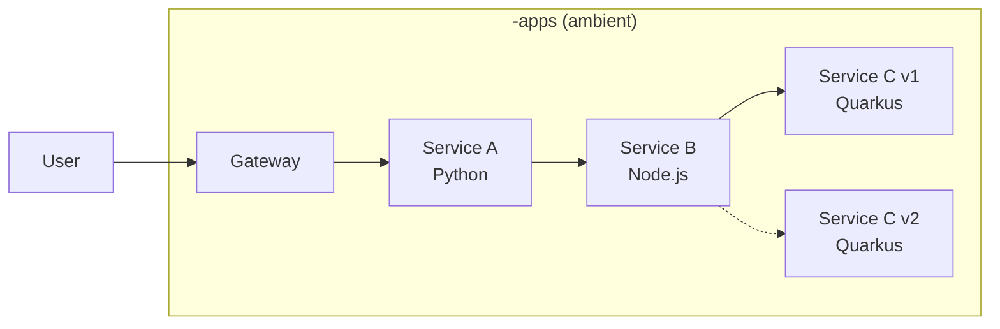

# Service Mesh 3 Ambient Workshop

Workshop demonstrating **Red Hat OpenShift Service Mesh 3** in ambient mode on OpenShift.

Three microservices form a call chain (A → B → C) to showcase Istio ambient mesh capabilities: **ztunnel** for L4 mTLS and **waypoint proxies** for L7 HTTP routing, authorization, observability, and resilience.

## Topics Covered

- **Security** — automatic mTLS, authorization policies, JWT authentication and authorization on the Gateway (Keycloak)
- **Observability** — Prometheus metrics, Perses dashboards, Kiali, distributed tracing (Tempo + OpenTelemetry)
- **Resilience** — circuit breakers, retries, canary releases, traffic mirroring

## Chapters

The workshop has two roles. The **admin** (`cluster-admin`) installs the platform and sets up the users. The **users** work in their own namespaces from the Web Terminal of the OpenShift console.

### Admin chapters

1. [Installation](admin-chapters/01-installation.md) — install operators, Istio ambient mesh, the observability/tracing stack, Keycloak and the Web Terminal
2. [Workshop Users](admin-chapters/02-user-setup.md) — create the users' namespaces, RBAC and Web Terminal tools
3. [Teardown](admin-chapters/03-teardown.md) — remove the workshop users, or the whole installation

### User chapters

1. [Getting Started](user-chapters/01-getting-started.md) — open the Web Terminal, clone the repository and load the workshop environment
2. [Deploy and Onboard the Apps](user-chapters/02-deploy-and-onboard.md) — deploy the demo apps, add them to the ambient mesh and explore Kiali, metrics and dashboards
3. [L4 Security](user-chapters/03-l4-security.md) — strict mTLS and identity-based authorization with the ztunnel
4. [Gateway and Waypoint Proxy](user-chapters/04-gateway-and-waypoint.md) — ingress with the Gateway API and L7 features with a waypoint proxy
5. [Distributed Tracing](user-chapters/05-distributed-tracing.md) — traces with Tempo and OpenTelemetry
6. [Authentication and Authorization on the Gateway](user-chapters/06-gateway-auth.md) — JWT validation and role-based access with Keycloak
7. [Canary Release](user-chapters/07-canary-release.md) — shift traffic gradually from v1 to v2
8. [Circuit Breaker](user-chapters/08-circuit-breaker.md) — outlier detection and retries
9. [Traffic Mirroring](user-chapters/09-traffic-mirroring.md) — send a copy of live traffic to a new version
10. [Ambient and Sidecar Side by Side](user-chapters/10-sidecar-interop.md) — run the apps with sidecars and route from ambient to sidecar workloads
