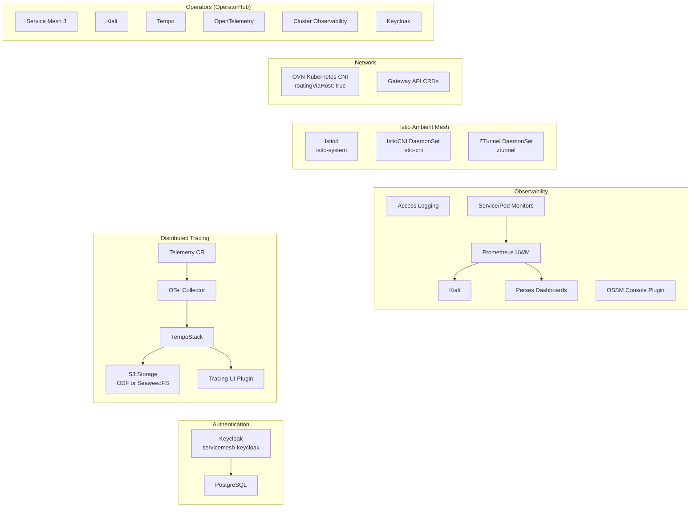

# 1. Installation

Tested versions: **OpenShift 4.22** and **Red Hat OpenShift Service Mesh 3.5** (Istio 1.31, Kiali 2.33). OpenShift Service Mesh 3.5 needs OpenShift 4.20 or later.

## Architecture Overview



## Install script (shortcut)

> [!WARNING]
> Use only if you do not want to learn how to setup and configure the required Service Mesh infrastructure but want to focus on **using** the mesh. 

Make sure you are logged in to your **OpenShift cluster** as an **administrator**. Tempo needs S3 object storage: the script uses **ODF** if it is installed, otherwise it deploys SeaweedFS (see the end of the page).

> [!TIP]
> For Red Hatters: use "Red Hat OpenShift Container Platform Cluster (Multi-Cloud)" from RHPD and select version 4.22, sno (single-node OpenShift) is sufficient.

```bash
./scripts/install.sh
```

Run the script (and all other commands of the workshop) from the root directory of this repository.

After the script has completed, move on to [2. Deploy and Onboard the Apps](02-deploy-and-onboard.md).

## Install the operators

First go to the Operator Hub and install the operators in the OpenShift Console UI or via

```bash
oc apply -f k8s/operators/subscriptions.yml
```

* Kiali Operator
* Red Hat OpenShift Service Mesh 3
* Tempo Operator
* Red Hat build of OpenTelemetry
* Cluster Observability Operator

The Red Hat build of Keycloak operator is installed later in its own namespace, see [Keycloak](#keycloak-oidc-identity-provider).
 
## Install Istio

OpenShift ships the Kubernetes Gateway API CRDs (4.19 and later), so we don't have to install them. Check that they are available:

```bash
oc get crd gateways.gateway.networking.k8s.io
```

Then we have to configure the OVN-Kubernetes Container Network Interface (CNI) for local gateway mode:

```bash
oc patch networks.operator.openshift.io cluster --type=merge -p '{
  "spec": {
    "defaultNetwork": {
      "ovnKubernetesConfig": {
        "gatewayConfig": {
          "routingViaHost": true
        }
      }
    }
  }
}'
```

This tells OVN-Kubernetes to route pod traffic to the outside world through the node’s host networking stack rather than through OVN’s distributed gateway routing. Ambient mode needs this so that liveness and readiness probes keep working for workloads in the mesh.

> [!NOTE]
> OpenShift 4.22 runs RHCOS 9 nodes by default. If your cluster has RHEL 10 or RHCOS 10 nodes (Technology Preview in 4.22), uncomment `nativeNftables: true` in `k8s/istio/istio.yml`, `k8s/istio/istio-cni.yml` and `k8s/tracing/istio-update.yml` before you continue.

Finally we install Istio, Istio-CNI and the ZTunnel for ambient mesh.

```bash
oc apply -k k8s/istio
```

We can verify the installation with `oc get pods -n istio-system` (there should be one pod running), `oc get daemonset -n istio-cni` (istio-cni-nodes should be ready on all nodes) and `oc get daemonset -n ztunnel` (ztunnels on all nodes).

## Observability

Check if the *cluster-monitoring-config* is available:

```bash
oc -n openshift-monitoring get configmap cluster-monitoring-config
```

If yes, enable workload monitoring:

```bash
oc -n openshift-monitoring patch configmap cluster-monitoring-config -p '{"data":{"config.yaml":"enableUserWorkload: true"}}'
```

If not, create it:

```bash
oc apply -f - <<EOF
kind: ConfigMap
apiVersion: v1
metadata:
  name: cluster-monitoring-config
  namespace: openshift-monitoring
data:
  config.yaml: |
    enableUserWorkload: true
EOF
```

Now we should have the prometheus-operator, prometheus-user-workload and thanos-ruler-user-workload running:

```bash
oc get pods -n openshift-user-workload-monitoring
```

Finally we create Service and Pod monitors, enable access logging and install Perses dashboards, Kiali, and the OpenShift Service Mesh console plugin.

```bash
oc apply -k k8s/observability
```

Perses dashboards are available in the OpenShift console under **Observe > Dashboards (Perses)**.

Kiali links its metrics pages to the Perses dashboards and its traces to the Distributed Tracing UI in the OpenShift console. For that, Kiali needs the URL of your OpenShift console:

```bash
export CONSOLE_URL="https://$(oc get route console -n openshift-console -o jsonpath='{.spec.host}')"
oc patch kiali kiali-user-workload-monitoring -n istio-system --type merge -p "{\"spec\":{\"external_services\":{\"perses\":{\"external_url\":\"${CONSOLE_URL}\"},\"tracing\":{\"external_url\":\"${CONSOLE_URL}\"}}}}"
```

Kiali is already configured to read traces from the TempoStack we create in [Distributed Tracing](#distributed-tracing). Until then, Kiali shows the tracing component as unreachable.

You will have to login to OpenShift again when the console plugin is installed. The URL to Kiali you'll find with:

```bash
echo "https://$(oc get route -n istio-system kiali -o jsonpath='{.spec.host}')"
```

## Distributed Tracing

### Tempostack

Prerequisite: **ODF is installed** on OpenShift. If not, install SeaweedFS instead (see [SeaweedFS instead of ODF](#seaweedfs-instead-of-odf) at the bottom) and continue with creating the TempoStack.

Create a bucket claim:

```bash
oc apply -f k8s/tracing/ns.yml
oc apply -f k8s/tracing/bucketclaim.yml
```

Then read the generated access keys and and export them as environment variables:

```bash
export S3_ENDPOINT="http://s3.openshift-storage.svc"
export AWS_ACCESS_KEY_ID=$(oc get secret tempostorage -n tempostack -o jsonpath='{.data.AWS_ACCESS_KEY_ID}' | base64 --decode)
export AWS_SECRET_ACCESS_KEY=$(oc get secret tempostorage -n tempostack -o jsonpath='{.data.AWS_SECRET_ACCESS_KEY}' | base64 --decode)
```

Now create the **TempoStack**:

```bash
envsubst < k8s/tracing/tempostack.yml | oc apply -f -
```

*If you don't have envsubst, replace the values manually in tempostack.yml.*

Create the OpenTelemetry collector, NetworkPolicies, Telemetry resource, and update Istio with tracing configuration:

```bash
oc apply -f k8s/tracing/otel-collector.yml
oc apply -f k8s/tracing/networkpolicies.yml
oc apply -f k8s/tracing/telemetry.yml
oc apply -f k8s/tracing/istio-update.yml
```

The OTel collector sends traces to the TempoStack gateway (port 8080) using OTLP HTTP with bearer token authentication from its ServiceAccount. The `tempostack` namespace has the `istio-discovery: enabled` label so the waypoint can discover the OTel collector service.

### Distributed Tracing UI Plugin

Apply the UIPlugin for the OpenShift console:

```bash
oc apply -f k8s/tracing/uiplugin.yml
```

As a console plugin is installed you'll have to login again to your OpenShift console. In "Observe" is a new entry "Traces".

## Keycloak (OIDC Identity Provider)

For authentication and authorization of external users on the Gateway we need an OIDC identity provider that issues JWTs. We install the Red Hat build of Keycloak with a PostgreSQL database in the namespace `servicemesh-keycloak`.

> [!NOTE]
> Many workshop clusters (e.g. RHDP) already run a Keycloak in the namespace `keycloak` (`sso.<cluster-domain>`) for the OpenShift console login. We deliberately use a separate namespace and hostname so we don't interfere with it.

Install the Keycloak operator:

```bash
oc apply -f k8s/keycloak/ns.yml
oc apply -f k8s/keycloak/subscription.yml
```

Wait until the operator is installed:

```bash
until oc get csv -n servicemesh-keycloak -l operators.coreos.com/rhbk-operator.servicemesh-keycloak 2>/dev/null | grep -q rhbk-operator; do sleep 3; done
oc wait csv -n servicemesh-keycloak -l operators.coreos.com/rhbk-operator.servicemesh-keycloak --for=jsonpath='{.status.phase}'=Succeeded --timeout=300s
```

Deploy PostgreSQL with a random password:

```bash
export KEYCLOAK_DB_PASSWORD=$(openssl rand -hex 12)
envsubst < k8s/keycloak/postgres.yml | oc apply -f -
oc rollout status deployment/keycloak-pgsql -n servicemesh-keycloak --timeout=180s
```

> [!WARNING]
> If you re-run this step and the PVC `keycloak-pgsql-data` already exists, reuse the old password (`oc get secret keycloak-pgsql-user -n servicemesh-keycloak -o jsonpath='{.data.password}' | base64 --decode`) or delete the PVC and secret first. A new password with an existing database breaks Keycloak.

Deploy Keycloak and its Route. The OpenShift router terminates TLS (edge) and Keycloak serves plain HTTP inside the cluster. The public URL `https://keycloak.<cluster-domain>` is used as the token issuer:

```bash
export KEYCLOAK_HOST="keycloak.$(oc get ingresses.config/cluster -o jsonpath='{.spec.domain}')"
envsubst < k8s/keycloak/keycloak.yml | oc apply -f -
oc wait keycloak/keycloak -n servicemesh-keycloak --for=condition=Ready --timeout=300s
```

Import the realm `servicemesh` with the OIDC client and two test users:

```bash
oc apply -f k8s/keycloak/keycloak-realm.yml
oc wait keycloakrealmimport/servicemesh -n servicemesh-keycloak --for=jsonpath='{.status.conditions[?(@.type=="Done")].status}'=True --timeout=300s
```

| Parameter     | Value                                                         |
| ------------- | ------------------------------------------------------------- |
| Issuer URL    | `https://keycloak.<cluster-domain>/realms/servicemesh`        |
| Client ID     | `servicemesh-app`                                             |
| Client secret | `servicemesh-app-secret`                                      |
| Test user     | `testuser` / `testuser` (realm role: `user`)                  |
| Admin user    | `adminuser` / `adminuser` (realm roles: `user`, `admin`)      |

Verify that you can get a token:

```bash
curl -s -X POST "https://${KEYCLOAK_HOST}/realms/servicemesh/protocol/openid-connect/token" \
  -d grant_type=password -d client_id=servicemesh-app -d client_secret=servicemesh-app-secret \
  -d username=testuser -d password=testuser | jq -r .access_token
```

The Keycloak admin console is available at `https://${KEYCLOAK_HOST}/admin`, the initial admin credentials are stored in the secret `keycloak-initial-admin`:

```bash
oc get secret keycloak-initial-admin -n servicemesh-keycloak -o jsonpath='{.data.username}' | base64 --decode; echo
oc get secret keycloak-initial-admin -n servicemesh-keycloak -o jsonpath='{.data.password}' | base64 --decode; echo
```

## Congratulations, you're done!

You've installed all operators and setup Service Mesh. Now move on to [2. Deploy and Onboard the Apps](02-deploy-and-onboard.md).

## SeaweedFS instead of ODF

If you do not have ODF and don't want to install and configure it, you can use [SeaweedFS](https://github.com/seaweedfs/seaweedfs) as an S3 compatible alternative. This setup is **not for production use**!

```bash
oc apply -f k8s/tracing/seaweedfs.yml
```

This deploys SeaweedFS in the namespace `seaweedfs` with an S3 access key "tempostorage" and secret key "tempostorage", and runs a Job that creates the bucket "tempostorage". Again, do not do that for production workloads. Wait until the bucket is created:

```bash
oc -n seaweedfs wait --for=condition=complete job/create-bucket --timeout=300s
```

Then set the environment variables

```bash
export S3_ENDPOINT="http://seaweedfs.seaweedfs.svc:8333"
export AWS_ACCESS_KEY_ID="tempostorage"
export AWS_SECRET_ACCESS_KEY="tempostorage"
```

...and continue with TempoStack (see section above).

---

[Overview](../README.md) | [2. Deploy and Onboard the Apps →](02-deploy-and-onboard.md)
