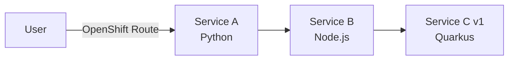

# 2. Deploy and Onboard the Apps

We're using the Service Mesh in ambient mode (L4) and with waypoint proxies (L7).

- **Ztunnel**  
Handles L4 (TCP) traffic management, primarily security. It provides connection-level load balancing, mTLS encryption (using HBONE), and L4 authorization. It does not read HTTP headers.
- **Waypoint Proxy**  
Handles L7 (HTTP/gRPC) traffic management. This is where the advanced, application-aware features are enabled.

In this chapter we deploy our apps, add them to the mesh (ztunnel only, L4) and explore the observability stack.

## Install the apps

We have 3 apps in a row: app A calls app B and app B calls app C.



The kustomization in `k8s/apps` creates:

| Resource                                     | Purpose                                                                                                  |
| -------------------------------------------- | -------------------------------------------------------------------------------------------------------- |
| Namespace `servicemesh-apps`                 | Labeled `istio-discovery: enabled` so Istio discovers it, but the namespace is **not** in the mesh yet  |
| ServiceAccounts `service-a`, `-b`, `-c`      | Every service gets its own identity. The mesh uses it for mTLS and authorization (see chapter 3)         |
| Deployments and Services                     | service-a, service-b and service-c v1                                                                    |
| PodMonitor `istio-proxies-monitor`           | Prometheus scrapes the Envoy proxies (Gateway, waypoint) in this namespace. Every mesh namespace needs one |
| Route `service-a`                            | Exposes service-a. We'll replace it with a Gateway in chapter 4                                         |

Our Istio control plane only watches namespaces with the discovery label (`discoverySelectors` in the `Istio` resource):

```yaml
kind: Namespace
metadata:
  name: servicemesh-apps
  labels:
    istio-discovery: enabled
```

Create the apps:

```bash
oc apply -k k8s/apps
```

Get the route and check if the apps are available.

```bash
export ROUTE="https://$(oc get route -n servicemesh-apps service-a -o jsonpath='{.spec.host}')"
curl $ROUTE
```

You should see something like

```text
Service A <- Service B <- Service C | v1 | 5vnhc | 1
```

The response of all downstream calls is added to the response of the first service A. Service C has some additional data in the response:

| Field   | Example | Meaning                                         |
| ------- | ------- | ----------------------------------------------- |
| version | `v1`    | Version of service-c (env variable `VERSION`)   |
| host    | `5vnhc` | Abbreviated pod name, tells which pod answered  |
| counter | `1`     | Number of calls this pod has handled            |

We'll use these to explore the Service Mesh features later.

## Onboard the apps to the Service Mesh

At the moment, the apps are known to the mesh (because of the label `istio-discovery: enabled` on the namespace), but not onboarded yet. You can verify that by checking the pods (no sidecars, still one container per pod) and the ztunnel:

```bash
istioctl ztunnel-config workload -n ztunnel
```


The apps in the `servicemesh-apps` namespace are listed, but there's no waypoint proxy and the protocol is **TCP** (should be **HBONE** in ambient mesh).

In ambient mode we don't inject sidecars or restart pods. Onboarding is a single label on the namespace:

```yaml
kind: Namespace
metadata:
  name: servicemesh-apps
  labels:
    istio-discovery: enabled
    istio.io/dataplane-mode: ambient   # new
```

```bash
oc label namespace servicemesh-apps istio.io/dataplane-mode=ambient
```

Istio CNI now redirects the traffic of every pod in the namespace to the ztunnel on its node. The ztunnels talk to each other through **HBONE** tunnels (HTTP-Based Overlay Network Environment), which are encrypted with mTLS. Check the ztunnel again:

```bash
istioctl ztunnel-config workload -n ztunnel
```


The protocol switched to **HBONE**. The pods were not restarted and still have a single container.

## Check Observability

If you check the Kiali Traffic Graph (Kiali console or integrated Kiali console in your OpenShift UI Console), you can see the service calls. As the Kiali traffic graph is built from real traffic, generate some in a second terminal and keep it running:

```bash
while true; do curl $ROUTE; sleep 2; done
```

### Kiali

In the OpenShift console UI, open 

```text
Service Mesh -> Traffic Graph 
```

Select the `servicemesh-apps` namespace. You see a graph of the traffic that flows through our services. The blue lines mean all traffic is going through our L4 ztunnel. If you activate *Security* in the *Display* menu and click on the new icons on the blue lines you see we have mTLS enabled.


### Metrics

In the OpenShift console UI, open 

```text
Observe -> Metrics
```

Enter the query:

```text
istio_tcp_connections_opened_total{destination_workload_namespace="servicemesh-apps"}
```

With the Thanos Querier we can access Istio metrics. The L4 metrics are reported by the ztunnel, so they belong to the `ztunnel` namespace; the labels `source_workload_namespace` and `destination_workload_namespace` tell which workloads are talking to each other.

At the moment we only have L4 (TCP) metrics. In chapter 4 we'll add a waypoint proxy for L7, which exposes HTTP metrics like `istio_requests_total`.


### Perses Dashboards

In the OpenShift console UI, open 

```text
Observe -> Dashboards (Perses)
```

Explore the provided dashboards like *Istio Ztunnel Dashboard* or *Istio Service Dashboard* and you can see the TCP traffic.


### Service Mesh tab on workloads

Also, if you go to

```text
Workloads -> Deployments
```

and open for example the `service-c-v1` deployment, you will find a *Service Mesh* tab with inbound traffic, Kiali information etc.


---

[← 1. Installation](01-installation.md) | [Overview](../README.md) | [3. L4 Security →](03-l4-security.md)
