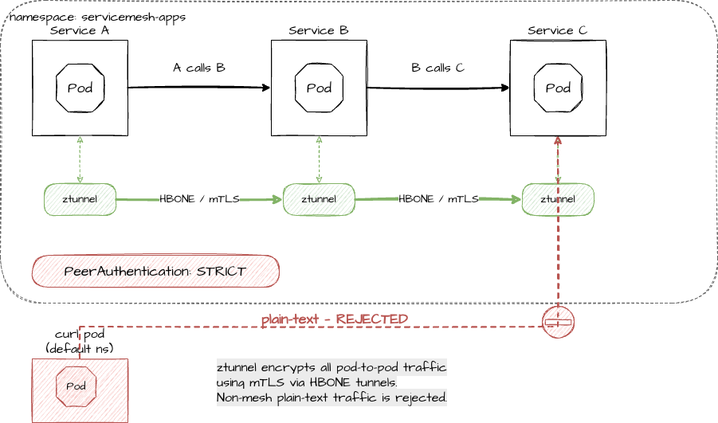
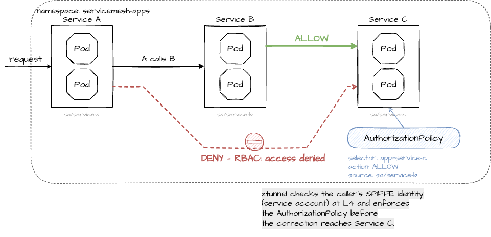

# 3. L4 Security (Ztunnel)

Before we move to L7 with waypoint proxies, let's demonstrate what the ztunnel can already do at L4: enforce strict mTLS and identity-based authorization. Both work without any change to the apps and without a waypoint proxy.

| Feature        | Istio resource        | Enforced by | Based on                              |
| -------------- | --------------------- | ----------- | ------------------------------------- |
| Strict mTLS    | `PeerAuthentication`  | ztunnel     | Is the connection mTLS (HBONE)?       |
| Authorization  | `AuthorizationPolicy` | ztunnel     | SPIFFE identity of the caller         |

## Preparation — curl test pods

If you're in a new terminal, set the `ROUTE` variable again:

```bash
export ROUTE="https://$(oc get route -n servicemesh-apps service-a -o jsonpath='{.spec.host}')"
```

Start a temporary curl pod in the `default` namespace (which is NOT enrolled in the mesh) and one in `servicemesh-apps` (which IS in the mesh):

```bash
oc run curl-test -n default --image=curlimages/curl --restart=Never -- sleep 3600
oc run curl-test -n servicemesh-apps --image=curlimages/curl --restart=Never -- sleep 3600
```

Wait until both pods are running:

```bash
oc wait pod/curl-test -n default --for=condition=Ready --timeout=60s
oc wait pod/curl-test -n servicemesh-apps --for=condition=Ready --timeout=60s
```

> [!NOTE]
> You may see a PodSecurity warning for the pod in `default`. The pod is created anyway.

## Strict mTLS



By default, Istio ambient mode uses *permissive* mTLS: mesh workloads accept both plain-text and mTLS traffic. This makes onboarding easy, as clients outside the mesh keep working. We can enforce that **only** mTLS traffic is allowed.

### Step 1 — Permissive mode (default)

The pod in `default` is not in the mesh and sends plain-text HTTP. In permissive mode this is **accepted**:

```bash
oc exec curl-test -n default -- curl -s -m 5 -w "\n" http://service-c.servicemesh-apps:8080/health
```

### Step 2 — Enforce strict mTLS

A `PeerAuthentication` with mode `STRICT` in the namespace `servicemesh-apps` tells the ztunnel to accept only mTLS connections for all workloads in this namespace:

```yaml
apiVersion: security.istio.io/v1
kind: PeerAuthentication
metadata:
  name: strict-mtls
  namespace: servicemesh-apps
spec:
  mtls:
    mode: STRICT
```

```bash
oc apply -f k8s/istiofeatures/mtls/peer-authentication.yml
```

**Test from outside the mesh:** The curl pod in `default` still sends plain-text HTTP, so it is now **rejected**:

```bash
oc exec curl-test -n default -- curl -s -m 5 -w "\n" http://service-c.servicemesh-apps:8080/health
```

The connection is reset because the ztunnel enforces mTLS and rejects plain-text traffic (curl exits with an error).

**Test from inside the mesh:** Now run the same curl from the pod in `servicemesh-apps`. The ztunnel transparently adds mTLS, so the request **succeeds**:

```bash
oc exec curl-test -n servicemesh-apps -- curl -s -m 5 -w "\n" http://service-c.servicemesh-apps:8080/health
```

You should get a healthy response. Neither the curl pod nor service-c knows anything about certificates: the ztunnel provides zero-config mTLS for all enrolled workloads.

| Caller                         | Permissive (default) | STRICT   |
| ------------------------------ | -------------------- | -------- |
| curl pod in `default` (no mesh) | allowed              | rejected |
| curl pod in `servicemesh-apps`  | allowed              | allowed  |

### Cleanup

Remove the strict mTLS policy and the curl pod in `default`. We keep the curl pod in `servicemesh-apps` for the next demo:

```bash
oc delete -f k8s/istiofeatures/mtls/peer-authentication.yml
oc delete pod curl-test -n default
```

## L4 Authorization Policy



The ztunnel can also enforce authorization at L4 based on the **SPIFFE identity** of the caller. Every workload in the mesh gets a certificate with an identity derived from its namespace and service account:

```text
spiffe://cluster.local/ns/<namespace>/sa/<service-account>
```

Our deployments use dedicated service accounts (`service-a`, `service-b`, `service-c`), so the ztunnel can distinguish between callers. The curl pod uses the `default` service account.

### Step 1 — Allow only service-b to call service-c

This `AuthorizationPolicy` selects the service-c pods and allows only connections with the identity of service-b. As soon as an `ALLOW` policy selects a workload, everything that doesn't match is denied:

```yaml
apiVersion: security.istio.io/v1
kind: AuthorizationPolicy
metadata:
  name: service-c-allow-service-b
  namespace: servicemesh-apps
spec:
  selector:
    matchLabels:
      app: service-c
  action: ALLOW
  rules:
  - from:
    - source:
        principals:
        - cluster.local/ns/servicemesh-apps/sa/service-b
```

The policy only uses L4 attributes (the identity of the caller), so the ztunnel can enforce it. Rules with L7 attributes like HTTP paths or headers would need a waypoint proxy.

```bash
oc apply -f k8s/istiofeatures/l4-authz/authorization-policy.yml
```

### Step 2 — Test

**The call chain:** The normal A -> B -> C call still works because service-b is the one calling service-c:

```bash
curl $ROUTE
```

**From the curl pod:** The curl pod in `servicemesh-apps` uses the `default` service account, not `service-b`. The ztunnel **denies** the request:

```bash
oc exec curl-test -n servicemesh-apps -- curl -s -m 5 -w "\n" http://service-c.servicemesh-apps:8080/health
```

The connection is closed by the ztunnel. Only the identity of service-b is allowed to reach service-c.

| Caller                              | Identity                  | Result  |
| ----------------------------------- | ------------------------- | ------- |
| service-b (call chain via `$ROUTE`) | `.../sa/service-b`        | allowed |
| curl pod in `servicemesh-apps`      | `.../sa/default`          | denied  |

You can also verify in the ztunnel logs that the connection was denied:

```bash
oc logs -n ztunnel -l app=ztunnel --tail=50 | grep "policy rejection"
```

### Cleanup

Remove the authorization policy and the curl pod:

```bash
oc delete -f k8s/istiofeatures/l4-authz/authorization-policy.yml
oc delete pod curl-test -n servicemesh-apps
```

---

[← 2. Deploy and Onboard the Apps](02-deploy-and-onboard.md) | [Overview](../README.md) | [4. Gateway and Waypoint Proxy →](04-gateway-and-waypoint.md)
