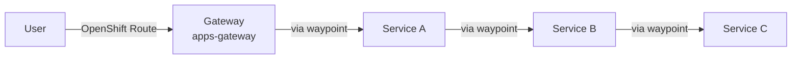

# 4. Gateway and Waypoint Proxy

At the moment we route traffic through a standard OpenShift Route into the mesh. We want to use a Gateway instead. And we only have Service Mesh functionality up to Layer 4 of the network stack with our ztunnel. For L7 features we have to deploy a waypoint proxy.

### Layer 7 features (require a waypoint proxy)

- **Traffic management**  
Advanced HTTP routing, load balancing, circuit breaking, rate limiting, fault injection, retries, timeouts
- **Security**  
Authorization policies based on L7 attributes such as request type or HTTP headers
- **Observability**  
HTTP metrics, access logging and tracing

Both the Gateway and the waypoint proxy are Envoy proxies that Istio deploys for a Kubernetes Gateway API `Gateway` resource. The `gatewayClassName` decides what it is:

| gatewayClassName  | What Istio deploys      | Traffic                                   |
| ----------------- | ----------------------- | ----------------------------------------- |
| `istio`           | Ingress Gateway         | North-south: from outside into the mesh   |
| `istio-waypoint`  | Waypoint proxy          | East-west: between services in the mesh   |

At the end of this chapter the traffic flows like this:



## Ingress Gateway

The Gateway listens for HTTP on port 80:

```yaml
apiVersion: gateway.networking.k8s.io/v1
kind: Gateway
metadata:
  name: apps-gateway
  namespace: servicemesh-apps
  annotations:
    networking.istio.io/service-type: ClusterIP
spec:
  gatewayClassName: istio
  listeners:
  - name: default
    port: 80
    protocol: HTTP
    allowedRoutes:
      namespaces:
        from: All
```

For every Gateway, Istio deploys a gateway proxy and creates a Service named `<gateway-name>-istio`. By default this Service is of type `LoadBalancer`. We annotate the Gateway with `networking.istio.io/service-type: ClusterIP` and point an OpenShift Route to the `apps-gateway-istio` Service instead, so the OpenShift router handles ingress (and TLS edge termination). Both are in the same file.

We create the Gateway and delete our old Route, as we're using the Gateway from now on:

```bash
oc apply -f k8s/apps_gateway_waypoint/gateway.yml
oc -n servicemesh-apps delete route service-a
```

The Gateway doesn't know where to send requests yet. An `HTTPRoute` attaches to the Gateway (`parentRefs`) and forwards all paths to service-a:

```yaml
apiVersion: gateway.networking.k8s.io/v1
kind: HTTPRoute
metadata:
  name: apps-gateway-default-route
  namespace: servicemesh-apps
spec:
  parentRefs:
  - name: apps-gateway
  rules:
  - matches:
    - path:
        type: PathPrefix
        value: /
    backendRefs:
    - name: service-a
      port: 8080
```

```bash
oc apply -f k8s/apps_gateway_waypoint/service-a-httproute.yml
```

Test the routing (note that `ROUTE` now points to the Gateway Route):

```bash
export ROUTE="https://$(oc get route -n servicemesh-apps apps-gateway -o jsonpath='{.spec.host}')"
curl $ROUTE
```

### Testing without waypoint proxy

Now generate some traffic in a second terminal:

```bash
export ROUTE="https://$(oc get route -n servicemesh-apps apps-gateway -o jsonpath='{.spec.host}')"
while true; do curl $ROUTE; sleep 3; done
```

Open Kiali (or use *Service Mesh* in the OpenShift console):

```bash
echo "https://$(oc get route -n istio-system kiali -o jsonpath='{.spec.host}')"
```

Check the *Traffic Graph* for the namespace `servicemesh-apps`. The traffic is routed from the Gateway through all services. The **traffic connection lines are blue**, which means all traffic is going through the ztunnel and we have Service Mesh functionality up to L4 of the network stack.


## Waypoint Proxy

For L7 functionality we create a waypoint proxy:

```yaml
apiVersion: gateway.networking.k8s.io/v1
kind: Gateway
metadata:
  name: waypoint
  namespace: servicemesh-apps
  labels:
    istio.io/waypoint-for: service
spec:
  gatewayClassName: istio-waypoint
  listeners:
  - name: mesh
    port: 15008
    protocol: HBONE
```

- `gatewayClassName: istio-waypoint` makes it a waypoint instead of an ingress gateway.
- The listener uses port 15008 with **HBONE**, the same mTLS tunnel protocol the ztunnels use. The ztunnels send traffic to the waypoint through HBONE.
- `istio.io/waypoint-for: service` means the waypoint handles traffic sent to **Services** (not traffic sent directly to pod IPs).

```bash
oc apply -f k8s/apps_gateway_waypoint/waypoint_proxy.yml
```

A waypoint proxy and the ingress gateway are now deployed next to the apps:

```bash
oc get pod -n servicemesh-apps
```

```text
NAME                                  READY   STATUS    RESTARTS   AGE
apps-gateway-istio-646fc5967c-cp9nm   1/1     Running   0          5m
service-a-6985b5f9ff-mpnsw            1/1     Running   0          30m
service-b-b5f98c95f-cwwz4             1/1     Running   0          30m
service-c-v1-74866b6c59-zz56z         1/1     Running   0          30m
waypoint-768dfb4859-vl666             1/1     Running   0          10s
```

### Enroll the services

Deploying the waypoint is not enough. We have to tell the mesh which services should use it. We label the namespace, so all services in it use the waypoint named `waypoint`:

```yaml
kind: Namespace
metadata:
  name: servicemesh-apps
  labels:
    istio-discovery: enabled
    istio.io/dataplane-mode: ambient
    istio.io/use-waypoint: waypoint   # new
```

```bash
oc label namespace servicemesh-apps istio.io/use-waypoint=waypoint
```

You can verify the waypoint proxy via *istioctl*. The column `WAYPOINT` shows `waypoint` for our services:

```bash
istioctl ztunnel-config svc -n ztunnel
```

```text
NAMESPACE        SERVICE NAME         SERVICE VIP     WAYPOINT ENDPOINTS
servicemesh-apps apps-gateway-istio   172.231.231.45  waypoint 1/1
servicemesh-apps service-a            172.231.9.178   waypoint 1/1
servicemesh-apps service-b            172.231.116.204 waypoint 1/1
servicemesh-apps service-c            172.231.19.29   waypoint 1/1
servicemesh-apps waypoint             172.231.53.208  None     1/1
```

As apps may use a persistent HTTP connection for downstream service calls, restart the deployments to make sure they will use the waypoint proxy:

```bash
oc rollout restart deployment/service-a -n servicemesh-apps
oc rollout restart deployment/service-b -n servicemesh-apps
```

### Ingress waypoint routing

If not instructed otherwise, the Gateway sends traffic directly to the destination pod and skips the waypoint. To make the Gateway send traffic to service-a through the waypoint (so we get L7 features for this hop too), we label the service the Gateway uses:

```bash
oc -n servicemesh-apps label service service-a istio.io/ingress-use-waypoint=true
```

| Label                                 | Set on    | Effect                                                         |
| ------------------------------------- | --------- | -------------------------------------------------------------- |
| `istio.io/dataplane-mode=ambient`     | Namespace | Pods are in the mesh (ztunnel, L4)                             |
| `istio.io/use-waypoint=waypoint`      | Namespace | Traffic to the services goes through the waypoint (L7)         |
| `istio.io/ingress-use-waypoint=true`  | Service   | Traffic from the Gateway to this service uses the waypoint too |

### Testing with waypoint proxy

Keep the traffic running (or start it again):

```bash
while true; do curl $ROUTE; sleep 3; done
```

In Kiali wait for the traffic data coming in and check the *Traffic Graph* for the namespace `servicemesh-apps`. The **traffic connection lines are changing to green**, which means the traffic is going through the waypoint proxy and we have Service Mesh functionality up to L7 of the network stack.


Also check the other observability dashboards we have already seen before. For example, the query below now has datapoints, as the waypoint reports HTTP metrics including the response codes:

```text
istio_requests_total{destination_workload_namespace="servicemesh-apps"}
```

---

[← 3. L4 Security](03-l4-security.md) | [Overview](../README.md) | [5. Distributed Tracing →](05-distributed-tracing.md)
