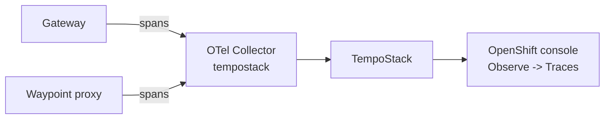
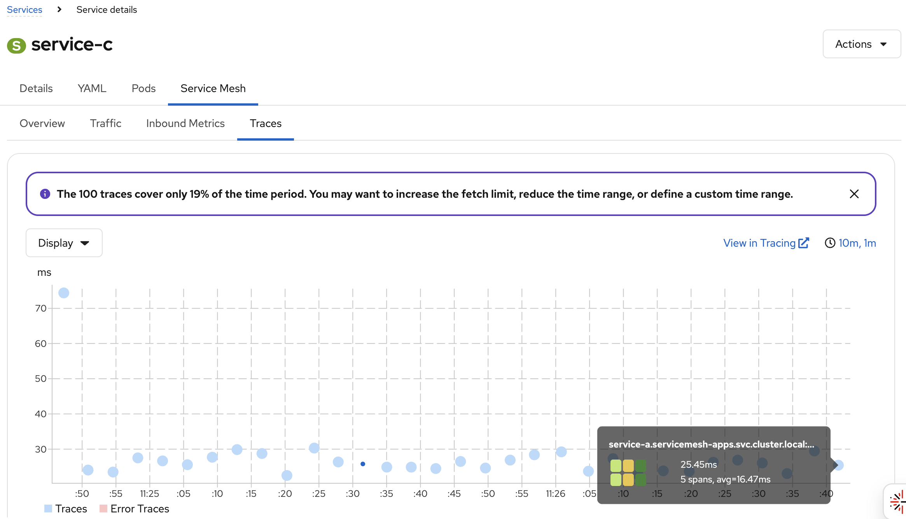

# 5. Distributed Tracing

Distributed tracing works by adding trace and span IDs to the HTTP headers. So with the L4 ambient mesh (ztunnel only) we do not get tracing data from the Service Mesh. Now that we have a waypoint proxy, the mesh can trace every HTTP request.



## How it is configured

We already configured tracing during the [installation](01-installation.md#distributed-tracing). Two resources are important.

The `Istio` resource registers the OpenTelemetry collector as tracing provider (`k8s/tracing/istio-update.yml`):

```yaml
spec:
  values:
    meshConfig:
      enableTracing: true
      extensionProviders:
      - name: otel
        opentelemetry:
          port: 4317
          service: otel-collector.tempostack.svc.cluster.local
```

A mesh-wide `Telemetry` resource in the root namespace `istio-system` enables tracing with this provider for all requests (`k8s/tracing/telemetry.yml`):

```yaml
apiVersion: telemetry.istio.io/v1
kind: Telemetry
metadata:
  name: mesh-default
  namespace: istio-system
spec:
  accessLogging:
    - providers:
      - name: envoy
  tracing:
    - providers:
        - name: otel
      randomSamplingPercentage: 100
```

> [!NOTE]
> We sample 100 % of the requests, which is good for a workshop. In production you would use a much lower sampling rate.

## Trace context propagation

The Gateway and the waypoint add tracing headers to incoming requests if there aren't any. But the mesh can't know that the request service-a sends to service-b belongs to the request service-a received. To see the full path in one trace, the apps have to **forward the tracing headers** (e.g. `traceparent`, `x-request-id` and the `x-b3-*` headers) when doing downstream service calls, see the [Istio docs](https://istio.io/latest/docs/tasks/observability/distributed-tracing/overview/#building-applications-to-support-trace-context-propagation).

Our apps do that, so we get one trace across the Gateway, service-a, service-b and service-c.

## Explore the traces

Generate some traffic (if it's not running anymore):

```bash
export ROUTE="https://$(oc get route -n servicemesh-apps apps-gateway -o jsonpath='{.spec.host}')"
while true; do curl $ROUTE; sleep 3; done
```

Open the Distributed Tracing UI in the OpenShift console:

```text
Observe -> Traces -> Tempo instance "tempostack" -> Tenant "dev"
```

Click on a trace to see the spans of the Gateway and the waypoint for every hop and how long each service took.


## Traces in Kiali

Kiali reads the traces from the same TempoStack and shows them next to the traffic graph and the metrics. It is configured in the `Kiali` resource (`k8s/observability/kiali.yml`):

```yaml
spec:
  external_services:
    tracing:
      enabled: true
      provider: tempo
      use_grpc: false
      use_waypoint_name: true
      internal_url: https://tempo-tempostack-gateway.tempostack.svc.cluster.local:8080/api/traces/v1/dev/tempo
      auth:
        type: bearer
        use_kiali_token: true
      tempo_config:
        url_format: openshift
        name: tempostack
        namespace: tempostack
        tenant: dev
```

| Field                | Meaning                                                                                                          |
| -------------------- | ---------------------------------------------------------------------------------------------------------------- |
| `internal_url`       | Tempo API of the tenant `dev`, behind the TempoStack gateway                                                     |
| `auth`               | Kiali authenticates with its ServiceAccount token. All authenticated users may read the `dev` tenant (ClusterRole `tempostack-traces-reader`) |
| `use_waypoint_name`  | The waypoint reports its spans as `waypoint.servicemesh-apps`, so Kiali looks up the traces of a service via its waypoint |
| `tempo_config`       | *View in Tracing* links open the trace in **Observe -> Traces** of the OpenShift console (`external_url` is the console URL) |

Keep the traffic running and open Kiali:

```bash
echo "https://$(oc get route -n istio-system kiali -o jsonpath='{.spec.host}')"
```

### Traces of a service

Select the namespace `servicemesh-apps` and go to

```text
Services -> service-c -> Traces
```

The chart shows one dot per trace that went through service-c: the time of the request on the x-axis and its duration on the y-axis. Hover over a dot for a summary (duration, number of spans), traces with errors are shown as *Error Traces* in red. Click on a dot to open the trace below the chart:

- **Trace Details** shows the trace with its spans and compares it with similar traces on the chart.
- **Span Details** lists every span: the Gateway and the waypoint for each hop to service-a, service-b and service-c, with duration and HTTP status code.

As our apps forward the trace headers, a trace of service-c contains the full path from the Gateway to service-c.

*View in Tracing* opens the same trace in **Observe -> Traces** of the OpenShift console, *View on Graph* shows its path in the Traffic Graph.

### Traces in the Traffic Graph

Go to the *Traffic Graph* of the namespace `servicemesh-apps` and click on the `service-c` service node. The side panel on the right now has a *Traces* tab with the latest traces. Click on a trace and Kiali highlights its path in the graph. *Show Traces* takes you to the *Traces* tab of the service.

### Traces in the OpenShift console

The OpenShift Service Mesh console plugin shows the same information without leaving the OpenShift console. Go to

```text
Networking -> Services -> service-c -> Service Mesh -> Traces
```

or use *Service Mesh -> Traffic Graph* as in the Kiali UI.



---

[← 4. Gateway and Waypoint Proxy](04-gateway-and-waypoint.md) | [Overview](../README.md) | [6. Authentication and Authorization on the Gateway →](06-gateway-auth.md)
