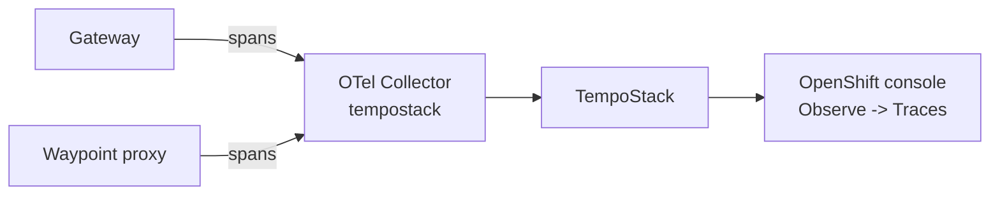

# 5. Distributed Tracing

Distributed tracing works by adding trace and span IDs to the HTTP headers. So with the L4 ambient mesh (ztunnel only) we do not get tracing data from the Service Mesh. Now that we have a waypoint proxy, the mesh can trace every HTTP request.



## How it is configured

We already configured tracing during the [installation](01-installation.md#distributed-tracing). Two resources are important.

The `Istio` resource registers the OpenTelemetry collector as tracing provider (`k8s/tracing/istio-update.yml`):

```yaml
spec:
  values:
    meshConfig:
      enableTracing: true
      extensionProviders:
      - name: otel
        opentelemetry:
          port: 4317
          service: otel-collector.tempostack.svc.cluster.local
```

A mesh-wide `Telemetry` resource in the root namespace `istio-system` enables tracing with this provider for all requests (`k8s/tracing/telemetry.yml`):

```yaml
apiVersion: telemetry.istio.io/v1
kind: Telemetry
metadata:
  name: mesh-default
  namespace: istio-system
spec:
  accessLogging:
    - providers:
      - name: envoy
  tracing:
    - providers:
        - name: otel
      randomSamplingPercentage: 100
```

> [!NOTE]
> We sample 100 % of the requests, which is good for a workshop. In production you would use a much lower sampling rate.

## Trace context propagation

The Gateway and the waypoint add tracing headers to incoming requests if there aren't any. But the mesh can't know that the request service-a sends to service-b belongs to the request service-a received. To see the full path in one trace, the apps have to **forward the tracing headers** (e.g. `traceparent`, `x-request-id` and the `x-b3-*` headers) when doing downstream service calls, see the [Istio docs](https://istio.io/latest/docs/tasks/observability/distributed-tracing/overview/#building-applications-to-support-trace-context-propagation).

Our apps do that, so we get one trace across the Gateway, service-a, service-b and service-c.

## Explore the traces

Generate some traffic (if it's not running anymore):

```bash
export ROUTE="https://$(oc get route -n servicemesh-apps apps-gateway -o jsonpath='{.spec.host}')"
while true; do curl $ROUTE; sleep 3; done
```

Open the Distributed Tracing UI in the OpenShift console:

```text
Observe -> Traces -> Tempo instance "tempostack" -> Tenant "dev"
```

Click on a trace to see the spans of the Gateway and the waypoint for every hop and how long each service took.


---

[← 4. Gateway and Waypoint Proxy](04-gateway-and-waypoint.md) | [Overview](../README.md) | [6. Authentication and Authorization on the Gateway →](06-gateway-auth.md)
