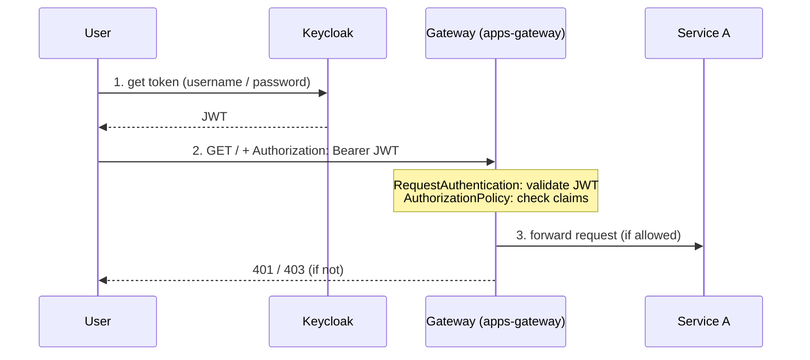

# 6. Authentication and Authorization on the Gateway

So far, every external user can call our apps through the Gateway. Now we protect the Gateway with **JWT authentication** using Keycloak as OIDC identity provider (installed in the namespace `servicemesh-keycloak`, see [Installation](01-installation.md#keycloak-oidc-identity-provider)) and add **role-based authorization** on top. Both are enforced by the Gateway proxy — the apps don't need to know anything about tokens.



We use two Istio resources, both attached to the Gateway with `targetRefs`:

- **RequestAuthentication** — *who are you?* Validates the JWT (signature, expiry, issuer) against the Keycloak signing keys (JWKS). istiod fetches the keys in-cluster from the Keycloak Service.
- **AuthorizationPolicy** — *what are you allowed to do?* Allows or denies requests based on the validated identity and the token claims.

## Preparation — get tokens from Keycloak

If you're in a new terminal, set the `ROUTE` variable again:

```bash
export ROUTE="https://$(oc get route -n servicemesh-apps apps-gateway -o jsonpath='{.spec.host}')"
```

Keycloak has a realm `servicemesh` with two users: `testuser` (realm role `user`) and `adminuser` (realm roles `user` and `admin`). Define a small helper to get a token for a user (requires `jq`):

```bash
export KEYCLOAK_HOST="keycloak.$(oc get ingresses.config/cluster -o jsonpath='{.spec.domain}')"

get_token() {
  curl -s -X POST "https://${KEYCLOAK_HOST}/realms/servicemesh/protocol/openid-connect/token" \
    -d grant_type=password -d client_id=servicemesh-app -d client_secret=servicemesh-app-secret \
    -d username=$1 -d password=$1 | jq -r .access_token
}

export USER_TOKEN=$(get_token testuser)
export ADMIN_TOKEN=$(get_token adminuser)
```

You can decode a token (e.g. on [jwt.io](https://jwt.io) or with the command below) and find the issuer `iss` and the roles in `realm_access.roles`:

```bash
echo $USER_TOKEN | cut -d. -f2 | jq -R 'gsub("-";"+") | gsub("_";"/") | . + ("=" * ((4 - length % 4) % 4)) | @base64d | fromjson | {iss, preferred_username, realm_access}'
```

> [!NOTE]
> Tokens expire after 5 minutes. If a previously working request suddenly returns 401, get new tokens.

## Step 1 — Authentication (RequestAuthentication)

The `RequestAuthentication` tells the Gateway which issuer it trusts and where to get the signing keys:

```yaml
spec:
  targetRefs:
  - group: gateway.networking.k8s.io
    kind: Gateway
    name: apps-gateway
  jwtRules:
  - issuer: https://${KEYCLOAK_HOST}/realms/servicemesh
    jwksUri: http://keycloak-service.servicemesh-keycloak.svc:8080/realms/servicemesh/protocol/openid-connect/certs
```

Apply it (the issuer contains the cluster domain, so we use `envsubst`):

```bash
envsubst < k8s/istiofeatures/gateway-auth/1-request-authentication.yml | oc apply -f -
```

Wait a few seconds for the configuration to reach the Gateway, then test:

```bash
# invalid token
curl -s -w " [HTTP %{http_code}]\n" -H "Authorization: Bearer invalid-token" $ROUTE
# valid token
curl -s -w " [HTTP %{http_code}]\n" -H "Authorization: Bearer $USER_TOKEN" $ROUTE
# no token
curl -s -w " [HTTP %{http_code}]\n" $ROUTE
```

The invalid token is rejected with **401**, the valid token is accepted with **200** — but the request **without** a token is accepted too!

This is intended: a `RequestAuthentication` only **validates tokens if they are present**. It rejects invalid tokens, but it does not require one. To enforce authentication we need an `AuthorizationPolicy`.

## Step 2 — Require a valid token (AuthorizationPolicy)

This policy only allows requests that have a *request principal*, i.e. a valid JWT (`<iss>/<sub>`) that was validated by the `RequestAuthentication`:

```yaml
spec:
  targetRefs:
  - group: gateway.networking.k8s.io
    kind: Gateway
    name: apps-gateway
  action: ALLOW
  rules:
  - from:
    - source:
        requestPrincipals: ["*"]
```

```bash
oc apply -f k8s/istiofeatures/gateway-auth/2-authorization-policy-require-jwt.yml
```

Test again:

```bash
# no token
curl -s -w " [HTTP %{http_code}]\n" $ROUTE
# valid token
curl -s -w " [HTTP %{http_code}]\n" -H "Authorization: Bearer $USER_TOKEN" $ROUTE
```

Now the request without a token is denied with **403** (`RBAC: access denied`) and only authenticated users get through.

## Step 3 — Role-based authorization

Authentication answers *who are you?* — authorization answers *what are you allowed to do?* Keycloak adds the realm roles of a user to the token claim `realm_access.roles`. We update the policy so that only users with the realm role `admin` can access the apps:

```yaml
  rules:
  - from:
    - source:
        requestPrincipals: ["*"]
    when:
    - key: request.auth.claims[realm_access][roles]
      values: ["admin"]
```

```bash
oc apply -f k8s/istiofeatures/gateway-auth/3-authorization-policy-require-admin.yml
```

Test with both users:

```bash
# testuser (role: user)
curl -s -w " [HTTP %{http_code}]\n" -H "Authorization: Bearer $USER_TOKEN" $ROUTE
# adminuser (roles: user, admin)
curl -s -w " [HTTP %{http_code}]\n" -H "Authorization: Bearer $ADMIN_TOKEN" $ROUTE
```

`testuser` is authenticated, but not authorized and gets a **403**. `adminuser` has the `admin` role and gets the response of our apps.

| Request                       | RequestAuthentication | + require JWT | + require admin role |
| ----------------------------- | --------------------- | ------------- | -------------------- |
| no token                      | 200                   | 403           | 403                  |
| invalid token                 | 401                   | 401           | 401                  |
| valid token, `testuser`       | 200                   | 200           | 403                  |
| valid token, `adminuser`      | 200                   | 200           | 200                  |

You can find both policies in Kiali under *Istio Config* for the namespace `servicemesh-apps`.

## Cleanup

Remove the authorization policy and the request authentication, so the Gateway is open again for the next chapters (Keycloak stays installed):

```bash
oc delete -f k8s/istiofeatures/gateway-auth/3-authorization-policy-require-admin.yml
oc delete -f k8s/istiofeatures/gateway-auth/1-request-authentication.yml
```

Verify that requests without a token work again:

```bash
curl $ROUTE
```

---

[← 5. Distributed Tracing](05-distributed-tracing.md) | [Overview](../README.md) | [7. Canary Release →](07-canary-release.md)
