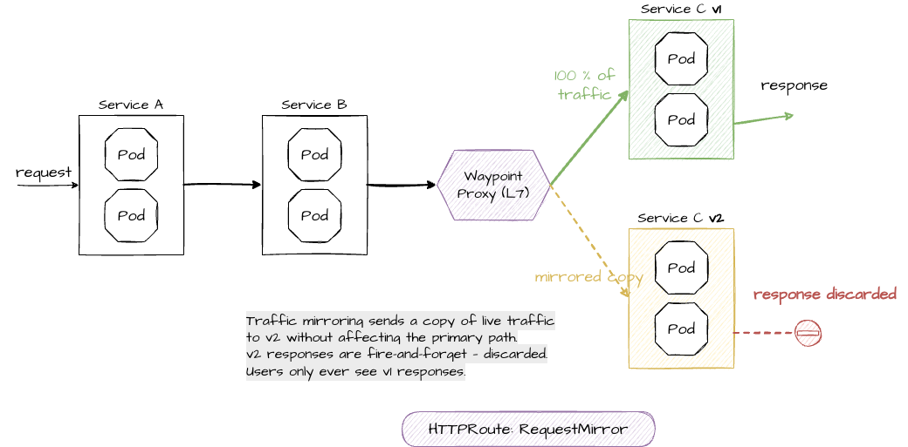

# 9. Traffic Mirroring

Traffic mirroring (also called shadowing) sends a copy of live traffic to a second service without affecting the primary request path. The mirrored requests are fire-and-forget — responses from the mirror target are discarded. This is useful for testing a new version with real production traffic before routing actual users to it.



We'll mirror 100 % of the traffic that goes to service-c-v1 to a freshly deployed service-c-v2.

| Canary release (chapter 7)               | Traffic mirroring                               |
| ---------------------------------------- | ----------------------------------------------- |
| Some users get responses from v2         | All users get responses from v1                 |
| v2 errors are visible to users           | v2 errors are invisible to users                |
| Traffic is **split** between v1 and v2   | Traffic is **copied** to v2                     |

## Preparation — Deploy v2 and version-specific Services

If you're in a new terminal, set the `ROUTE` variable again:

```bash
export ROUTE="https://$(oc get route -n servicemesh-apps apps-gateway -o jsonpath='{.spec.host}')"
```

We need the version-specific Services (`service-c-v1`, `service-c-v2`) and the v2 Deployment. These are the same resources we used in the canary demo:

```bash
oc apply -f k8s/istiofeatures/canary/0-service-c-versions.yml
oc apply -f k8s/istiofeatures/canary/c-v2-deploy.yml
```

Wait for v2 to be ready:

```bash
oc rollout status deployment/service-c-v2 -n servicemesh-apps
```

## Step 1 — Apply the mirror HTTPRoute

Like in the canary release, the `HTTPRoute` has the `service-c` Service as parent and is processed by the waypoint proxy. It routes all traffic to `service-c-v1`, and the `RequestMirror` filter sends a copy of every request to `service-c-v2`:

```yaml
apiVersion: gateway.networking.k8s.io/v1
kind: HTTPRoute
metadata:
  name: service-c-mirror
  namespace: servicemesh-apps
spec:
  parentRefs:
  - group: ""
    kind: Service
    name: service-c
    port: 8080
  rules:
  - filters:
    - type: RequestMirror
      requestMirror:
        backendRef:
          name: service-c-v2
          port: 8080
    backendRefs:
    - name: service-c-v1
      port: 8080
```

```bash
oc apply -f k8s/istiofeatures/mirroring/1-mirror-httproute.yml
```

## Step 2 — Generate traffic and verify

First, check the v2 call counter before sending any traffic:

```bash
export V2_POD=$(oc get pods -n servicemesh-apps -l app=service-c,version=v2 -o jsonpath='{.items[0].metadata.name}')
oc port-forward -n servicemesh-apps $V2_POD 8080:8080 &
```

```bash
curl http://localhost:8080/
kill %1
```

Note the call counter. Now generate traffic through the normal route:

```bash
for i in $(seq 1 10); do curl $ROUTE; sleep 1; done
```

All responses come from **v1** only — the user never sees v2 responses because mirrored traffic is fire-and-forget.

Now check the v2 call counter again:

```bash
oc port-forward -n servicemesh-apps $V2_POD 8080:8080 &
```

```bash
curl http://localhost:8080/
kill %1
```

The counter should have jumped up by 11 (10 mirrored requests plus your own check) — proving v2 received copies of the live traffic even though no user-facing response ever came from v2.


## Cleanup

```bash
oc delete -f k8s/istiofeatures/mirroring/1-mirror-httproute.yml
oc delete -f k8s/istiofeatures/canary/c-v2-deploy.yml
oc delete -f k8s/istiofeatures/canary/0-service-c-versions.yml
```

---

> [!NOTE]
> **Why do we mix Gateway API and Istio APIs?**
>
> You may have noticed that we used Gateway API `HTTPRoute` for canary releases and traffic mirroring, but Istio `DestinationRule` and `VirtualService` for the circuit breaker and retries. If you're familiar with sidecar-based Istio, you'd expect `VirtualService` + `DestinationRule` for everything.
>
> In ambient mode, **Gateway API is the recommended API for traffic routing** and replaces `VirtualService` wherever it can:
>
>
> | Feature                              | API               | Why                                             |
> | ------------------------------------ | ----------------- | ----------------------------------------------- |
> | Weighted routing (canary)            | `HTTPRoute`       | Core Gateway API — `backendRefs` with `weight`  |
> | Traffic mirroring                    | `HTTPRoute`       | Core Gateway API — `RequestMirror` filter       |
> | Circuit breaking / outlier detection | `DestinationRule` | No Gateway API equivalent exists                |
> | Retries                              | `VirtualService`  | Gateway API retry support is still experimental |
>
>
> The rule of thumb: **use Gateway API when it covers your use case, fall back to Istio APIs for the gaps.** The waypoint proxy processes both — they work side by side.

---

[← 8. Circuit Breaker](08-circuit-breaker.md) | [Overview](../README.md) | [10. Ambient and Sidecar Side by Side →](10-sidecar-interop.md)
