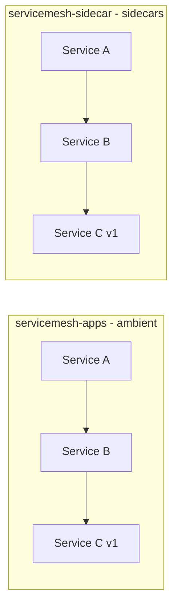
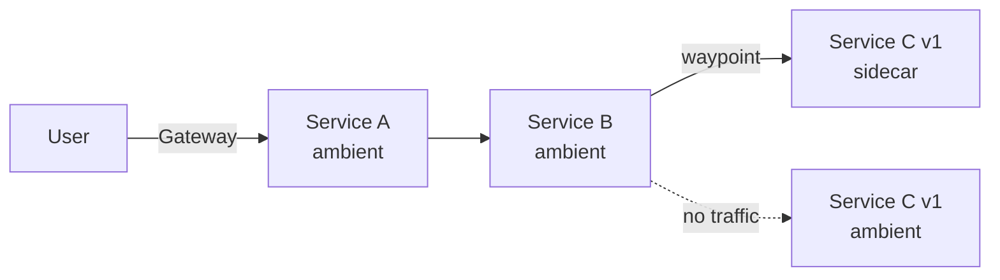

# 10. Ambient and Sidecar Side by Side

So far all our apps run in ambient mode. Istio still supports the classic **sidecar mode**, where every pod gets its own Envoy proxy. Both modes can run in the same mesh: they share the control plane (istiod), the certificate authority and the trust domain. This is useful when you migrate from sidecars to ambient step by step, or when some workloads need sidecar-specific features.

| | Ambient | Sidecar |
| --- | --- | --- |
| Onboarding | Namespace label `istio.io/dataplane-mode=ambient`, no restart | Namespace label `istio-injection=enabled`, pods must be (re)created |
| L4 (mTLS, L4 AuthZ) | ztunnel on every node | Envoy sidecar in every pod |
| L7 (routing, L7 AuthZ, tracing) | Waypoint proxy (optional) | Envoy sidecar in every pod |
| Pod | One container per app | App container + `istio-proxy` |

In this chapter we deploy a second copy of our apps with sidecars, explore it in Kiali and then send the traffic of the ambient service-b to the service-c in the sidecar namespace.

## Deploy the apps with sidecars



The kustomization in `k8s/sidecar` reuses the manifests from `k8s/apps` and deploys them into the namespace `servicemesh-sidecar`. The only difference is the label on the namespace:

```yaml
kind: Namespace
metadata:
  name: servicemesh-sidecar
  labels:
    istio-discovery: enabled   # Istio discovers the namespace
    istio-injection: enabled   # new: sidecars are injected into all new pods
```

The label `istio-injection: enabled` tells the istiod webhook to add the `istio-proxy` container to every pod created in this namespace. The namespace does **not** have the label `istio.io/dataplane-mode=ambient`, so the ztunnel doesn't handle its traffic.

```bash
oc apply -k k8s/sidecar
oc rollout status deployment -n servicemesh-sidecar
```

Check the pods:

```bash
oc get pods -n servicemesh-sidecar
```

This time every pod has **two** containers (`2/2`): the app and the `istio-proxy` sidecar:

```text
NAME                            READY   STATUS    RESTARTS   AGE
service-a-7cbfdf455-2lbdc       2/2     Running   0          13s
service-b-647f676c98-zf95r      2/2     Running   0          12s
service-c-v1-74866b6c59-5b9cz   2/2     Running   0          12s
```

The Istio CNI we installed for ambient mode also redirects the traffic of the sidecar pods to their `istio-proxy`, so the pods don't need privileged init containers.

Now check the ztunnel again:

```bash
istioctl ztunnel-config workload -n ztunnel
```

The sidecar pods are listed too, with protocol **HBONE**. Their traffic doesn't go through the ztunnel, but istiod tells the ztunnels that the sidecars accept HBONE connections (on port 15008). This is how ambient workloads reach sidecar workloads with mTLS.

The kustomization also created a Route for the service-a in the sidecar namespace. Call it:

```bash
export SIDECAR_ROUTE="https://$(oc get route -n servicemesh-sidecar service-a -o jsonpath='{.spec.host}')"
curl $SIDECAR_ROUTE
```

```text
Service A <- Service B <- Service C | v1 | 5b9cz | 1
```

## Check Observability

Generate some traffic in a second terminal and keep it running:

```bash
while true; do curl $SIDECAR_ROUTE; sleep 2; done
```

### Kiali

In the OpenShift console UI, open

```text
Service Mesh -> Traffic Graph
```

Select the `servicemesh-sidecar` namespace. In the ambient namespace we only had L4 (TCP) edges until we added a waypoint proxy in chapter 4. Here we have HTTP edges right away, because every sidecar is a full L7 proxy. Activate *Security* in the *Display* menu: all calls are mTLS.

Open one of the workloads, for example `service-c-v1`, and compare it with the same workload in `servicemesh-apps`: Kiali shows the `istio-proxy` sidecar in the pod details, while the workloads in `servicemesh-apps` are marked as ambient.

### Traces

The sidecars use the same mesh-wide `Telemetry` resource as the waypoint proxy (chapter 5), so they send their spans to the OpenTelemetry Collector as well. Open the *Traces* tab of the `service-c-v1` workload in Kiali, or

```text
Observe -> Traces
```

You see the full call chain A -> B -> C. Each sidecar reports a span for its outbound and inbound side of a call.

You can stop the traffic loop now.

## Route from ambient to the sidecar namespace

Now let's connect both worlds: the ambient service-b should call the service-c in the sidecar namespace, without changing service-b. service-b calls `service-c:8080`, so we redirect the `service-c` Service of `servicemesh-apps` with the waypoint proxy.



If you're in a new terminal, set the `ROUTE` variable again:

```bash
export ROUTE="https://$(oc get route -n servicemesh-apps apps-gateway -o jsonpath='{.spec.host}')"
```

### Step 1 — Allow the cross-namespace reference

An `HTTPRoute` may only send traffic to a Service in another namespace if the target namespace allows it. The owner of `servicemesh-sidecar` does this with a `ReferenceGrant`:

```yaml
apiVersion: gateway.networking.k8s.io/v1beta1
kind: ReferenceGrant
metadata:
  name: allow-servicemesh-apps
  namespace: servicemesh-sidecar
spec:
  from:
  - group: gateway.networking.k8s.io
    kind: HTTPRoute
    namespace: servicemesh-apps
  to:
  - group: ""
    kind: Service
    name: service-c
```

| Field       | Meaning                                                                 |
| ----------- | ----------------------------------------------------------------------- |
| `namespace` | The `ReferenceGrant` lives in the namespace that is referenced          |
| `from`      | HTTPRoutes in `servicemesh-apps` may reference ...                      |
| `to`        | ... the Service `service-c` (and nothing else) in this namespace        |

```bash
oc apply -f k8s/sidecar/1-reference-grant.yml
```

### Step 2 — Route service-c to the sidecar namespace

The `HTTPRoute` looks like the one from the canary release (chapter 7): it has the `service-c` Service as parent and is processed by the waypoint proxy. The difference is the `namespace` in the `backendRefs`:

```yaml
apiVersion: gateway.networking.k8s.io/v1
kind: HTTPRoute
metadata:
  name: service-c-to-sidecar
  namespace: servicemesh-apps
spec:
  parentRefs:
  - group: ""
    kind: Service
    name: service-c
    port: 8080
  rules:
  - backendRefs:
    - kind: Service
      name: service-c
      namespace: servicemesh-sidecar
      port: 8080
```

```bash
oc apply -f k8s/sidecar/2-httproute-service-c.yml
```

Check the status of the route. `ResolvedRefs` is only `True` if the `ReferenceGrant` allows the cross-namespace reference:

```bash
oc get httproute service-c-to-sidecar -n servicemesh-apps \
  -o jsonpath='{range .status.parents[*].conditions[*]}{.type}={.status}{"\n"}{end}'
```

```text
Accepted=True
ResolvedRefs=True
ResolvedWaypoints=True
```

Generate traffic and keep it running:

```bash
while true; do curl $ROUTE; sleep 2; done
```

The host in the response changed: service-c is now answered by the pod in the sidecar namespace. Compare it with:

```bash
oc get pods -n servicemesh-sidecar -l app=service-c
```

The path of a request is now: Gateway -> waypoint -> service-a -> service-b -> ztunnel -> waypoint -> **HBONE tunnel to the sidecar** of service-c. The waypoint connects to the sidecar on port 15008 with mTLS, the same way it connects to the ztunnel of an ambient pod.

### Step 3 — Scale down the ambient service-c (optional)

The ambient service-c doesn't get any traffic anymore. To show that we really don't depend on it, scale it down:

```bash
oc scale deployment service-c-v1 -n servicemesh-apps --replicas=0
```

The responses don't change. The `service-c` Service in `servicemesh-apps` has no pods anymore, but the waypoint doesn't send traffic to its pods, it sends it to the backend of the `HTTPRoute`.

### Kiali

In the Traffic Graph, select both namespaces, `servicemesh-apps` and `servicemesh-sidecar`. You see the edge from the waypoint proxy in `servicemesh-apps` to `service-c-v1` in `servicemesh-sidecar`. With *Security* activated in the *Display* menu, you see that this call across the two data plane modes is mTLS as well.

A trace of a request now also spans both namespaces: the spans of the Gateway and the waypoint proxy in `servicemesh-apps`, and the spans of the service-c sidecar in `servicemesh-sidecar`.

## mTLS and authorization across the modes

Let's see how security policies behave when traffic crosses from ambient to sidecars. Keep the traffic loop running.

### Step 1 — Strict mTLS for the sidecar namespace

Same `PeerAuthentication` as in chapter 3, but for `servicemesh-sidecar`. This time it is enforced by the sidecars instead of the ztunnel:

```yaml
apiVersion: security.istio.io/v1
kind: PeerAuthentication
metadata:
  name: strict-mtls
  namespace: servicemesh-sidecar
spec:
  mtls:
    mode: STRICT
```

```bash
oc apply -f k8s/sidecar/3-peer-authentication.yml
```

The responses don't change. The waypoint proxy connects to the sidecar of service-c with mTLS, so strict mode doesn't break anything. Ambient and sidecar workloads use certificates from the same CA, so they trust each other.

### Step 2 — Allow only service-b to call service-c

In chapter 3 we allowed only the identity of service-b to call service-c. Let's apply the same policy to the service-c in the sidecar namespace:

```yaml
apiVersion: security.istio.io/v1
kind: AuthorizationPolicy
metadata:
  name: service-c-allow
  namespace: servicemesh-sidecar
spec:
  selector:
    matchLabels:
      app: service-c
  action: ALLOW
  rules:
  - from:
    - source:
        principals:
        - cluster.local/ns/servicemesh-apps/sa/service-b
```

```bash
oc apply -f k8s/sidecar/4-authorization-policy-service-b.yml
```

After a few seconds, the requests are **denied**:

```text
Service A <- Service B <- Error: RBAC: access denied
```

Why? service-b calls service-c, but the call goes through the waypoint proxy. The waypoint terminates the connection of service-b, handles the HTTP request and opens a **new** mTLS connection to service-c with its own identity. So the sidecar of service-c sees the identity of the waypoint, not of service-b:

```text
spiffe://cluster.local/ns/servicemesh-apps/sa/waypoint
```

You can see it in the access log of the sidecar: the request is rejected (`403`, `rbac_access_denied`) and the source address is the IP of the waypoint pod:

```bash
oc logs -n servicemesh-sidecar deployment/service-c-v1 -c istio-proxy --tail=1
oc get pods -n servicemesh-apps -l gateway.networking.k8s.io/gateway-name=waypoint -o wide
```

> [!NOTE]
> This is not specific to sidecars. In chapter 3 the policy worked because we had no waypoint proxy yet. As soon as a waypoint is in the path, the destination sees the identity of the waypoint. To authorize the original caller, attach the `AuthorizationPolicy` to the waypoint (with `targetRefs`) — the waypoint knows the identity of service-b.

### Step 3 — Allow the waypoint

Allow the identity of the waypoint proxy instead:

```yaml
  rules:
  - from:
    - source:
        principals:
        - cluster.local/ns/servicemesh-apps/sa/waypoint
```

```bash
oc apply -f k8s/sidecar/5-authorization-policy-waypoint.yml
```

After a few seconds the requests succeed again.

> [!NOTE]
> **Limitation: sidecars don't use waypoint proxies**
>
> In this chapter ambient workloads call sidecar workloads. The other direction (sidecar -> ambient) works with mTLS as well, but a sidecar doesn't send its requests through the waypoint of the destination: it connects directly to the destination pod. So L7 policies, routes and spans of a waypoint don't apply to requests from sidecar workloads.

## Cleanup

Scale the ambient service-c up again and remove the HTTPRoute, so that service-b calls the ambient service-c again. Then delete the sidecar namespace. The `ReferenceGrant`, the `PeerAuthentication` and the `AuthorizationPolicy` are in this namespace and are deleted with it:

```bash
oc scale deployment service-c-v1 -n servicemesh-apps --replicas=1
oc delete -f k8s/sidecar/2-httproute-service-c.yml
oc delete -k k8s/sidecar
```

Check that the ambient service-c answers again:

```bash
oc get pods -n servicemesh-apps -l app=service-c
curl $ROUTE
```

---

## Congratulations, you're done!

You have successfully explored Istio Service Mesh on OpenShift in ambient mode — from L4 security with the ztunnel all the way to L7 traffic management with waypoint proxies, and side by side with sidecars.

---

[← 9. Traffic Mirroring](09-traffic-mirroring.md) | [Overview](../README.md)
